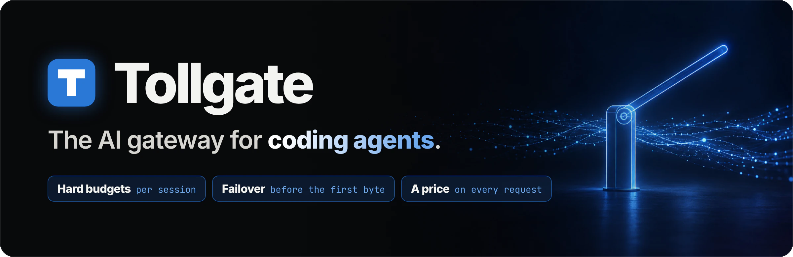
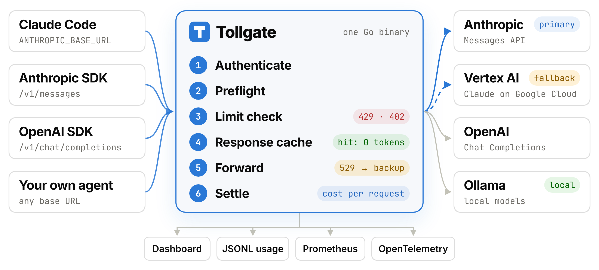
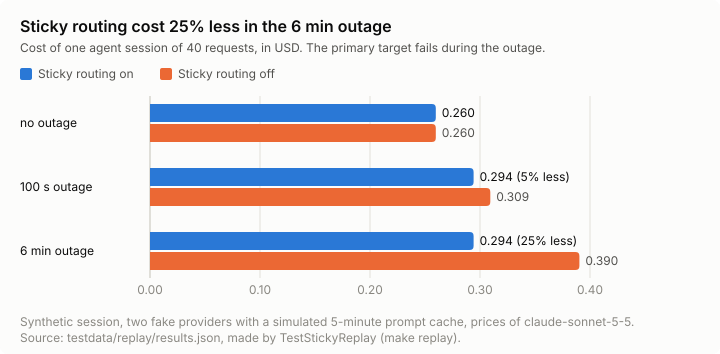

<a href="https://github.com/ykakade/tollgate">
  
</a>

<h3 align="center">Put your coding agents on a budget.</h3>

<p align="center">
  Tollgate is a self-hosted gateway for Claude Code and any agent that uses the Anthropic or OpenAI API.<br>
  It refuses requests that would go over a budget, fails over when a provider goes down, and prices every request.<br>
  <strong>Two environment variables. No code changes. One Go binary.</strong>
</p>

<p align="center">
  <a href="https://github.com/ykakade/tollgate/actions/workflows/ci.yml"></a>
  <a href="https://github.com/ykakade/tollgate/releases/latest"></a>
  <a href="go.mod"></a>
  <a href="LICENSE"></a>
  <a href="https://ykakade.github.io/tollgate/"></a>
</p>

<p align="center">
  <a href="#quick-start"><strong>Quick start</strong></a> ·
  <a href="#how-it-works"><strong>How it works</strong></a> ·
  <a href="#see-it-work"><strong>See it work</strong></a> ·
  <a href="#features"><strong>Features</strong></a> ·
  <a href="https://ykakade.github.io/tollgate/"><strong>Documentation</strong></a> ·
  <a href="#faq"><strong>FAQ</strong></a>
</p>

## Why Tollgate

Coding agents do not spend money like chat apps. One task can send hundreds of large requests and run for an hour while nobody watches the meter. One bad minute at the provider can stop the task.

| Without Tollgate | With Tollgate |
| --- | --- |
| An agent stuck in a loop spends the month's budget overnight. | Each session and each month has a hard budget. Tollgate reserves the estimated cost **before** it sends a request, and refuses with HTTP 402 when the money is gone. |
| The provider returns `529 Overloaded`, and an hour-long task stops. | Tollgate fails over to the next target, such as a second account or Claude on Vertex AI, **before the first byte** reaches the agent. The agent gets a normal response. |
| The invoice goes up, and nobody knows which task spent the money. | Tollgate prices every request and tags it with its tenant, key, and session. The dashboard and `tollgate report` show where the money went. |
| Ten agents share one provider key, with no limits. | Each person or agent gets its own Tollgate key, with its own models, rate limits, and budget. The provider key stays on the gateway. |

## Quick start

### Try it with no API key

Prerequisites: Git, GNU Make, Node.js, and the Go version in [`go.mod`](go.mod).

```sh
git clone https://github.com/ykakade/tollgate.git && cd tollgate
make dashboard-demo
```

Open `http://127.0.0.1:9090`. Tollgate runs with fake providers, 7 days of synthetic history, and live agent-like sessions. One fake provider always fails, so you can watch failover and circuit breakers at work. Stop the demo with `Ctrl-C`.

### Put Claude Code behind Tollgate

1. Install Tollgate:

   ```sh
   go install github.com/ykakade/tollgate/cmd/tollgate@latest
   ```

2. Download the Claude Code example configuration, and make a key:

   ```sh
   curl -fsSLO https://raw.githubusercontent.com/ykakade/tollgate/main/examples/claude-code/tollgate.yaml
   tollgate keys create -id laptop
   ```

   In `tollgate.yaml`, remove `[]` after `keys:` and add the two lines that the command shows. Keep the key that starts with `tg_`.

3. Start the gateway with your Anthropic API key:

   ```sh
   export ANTHROPIC_API_KEY='YOUR_ANTHROPIC_API_KEY'
   tollgate serve -config tollgate.yaml
   ```

4. In a second terminal, start Claude Code with the Tollgate address, the Tollgate key, and a session name:

   ```sh
   export ANTHROPIC_BASE_URL=http://127.0.0.1:8080
   export ANTHROPIC_AUTH_TOKEN='YOUR_TOLLGATE_KEY'
   export ANTHROPIC_CUSTOM_HEADERS='x-tollgate-session: my-task'
   claude
   ```

**Result:** Claude Code works as usual. The task `my-task` has a $5 session budget, the month has a $50 budget, and each request writes its cost to `data/usage.jsonl`. Open `http://127.0.0.1:9090` to see the spend.

<details>
<summary><strong>Other ways to install</strong></summary>

- **Release binaries:** Linux archives for amd64 and arm64 are on the [releases page](https://github.com/ykakade/tollgate/releases/latest). Each release has checksums, a keyless cosign signature, and GitHub build provenance. The [installation guide](docs/quickstart.md#install-a-release-binary) shows how to verify them.
- **From source:** clone the repository and run `make build`. The binaries are in `bin/`.
- **Full demo stack:** with Docker Compose, `make demo` starts Tollgate with fake providers, a load generator, Prometheus, Grafana, and Jaeger. See [observability](docs/observability.md#demo-stack).

</details>

> [!NOTE]
> Tollgate is alpha software (v0.1.0). The configuration format can change before v1.0. Read the [budget tolerances](docs/limits.md#worst-case-overspend) before you depend on a budget.

## How it works

<picture>
  <source media="(prefers-color-scheme: dark)" srcset="docs/assets/readme-flow-dark.webp">
  
</picture>

Clients keep their native API and change only the base URL and the key. For each request, Tollgate:

1. **Authenticates** the Tollgate key and finds its tenant, models, and limits.
2. **Estimates** the input tokens and reads `max_tokens` from the request.
3. **Reserves** the rate limit and the estimated cost. If the tenant is over a limit, the request stops here with 429 or 402.
4. **Checks** the opt-in response cache. A hit costs no provider tokens.
5. **Forwards** the request to the first healthy target. If that target fails before the first response byte, Tollgate tries the next one.
6. **Settles** the real cost from the reported usage, and writes one usage event.

Streams pass through byte for byte, unless redaction or a budget cutoff changes them. One process keeps its state in memory. Several copies share limits and budgets through Redis.

## See it work

<a href="https://ykakade.github.io/tollgate/#see-it-work"></a>

<p align="center"><sub>The 81-second tour. <a href="https://ykakade.github.io/tollgate/#see-it-work">Watch it in 1080p</a>, or read <a href="docs/video/README.md">how it is made</a>.</sub></p>

### Real output

This is real output from a local run with two [fake providers](cmd/fakeprovider). The primary always returns 529, and the session budget is $0.01.

The primary fails, so Tollgate sends the request to the backup. The response headers tell you what happened:

```http
HTTP/1.1 200 OK
X-Tollgate-Attempts: 2
X-Tollgate-Cache: bypass
X-Tollgate-Model: claude-sonnet-5-5
X-Tollgate-Overhead-Ms: 0.068
X-Tollgate-Provider: backup
X-Tollgate-Session-Remaining-Usd: 0.007944
```

69 requests later, the session budget is spent. Tollgate refuses request 70 with `402 Payment Required`, in the error format of the caller's API, and the provider never sees it:

```json
{
  "type": "error",
  "error": {
    "type": "budget_exceeded",
    "message": "The session \"fix-flaky-test\" does not have sufficient budget for this request. The session budget is 0.01 USD, and the spend is 0.008004 USD. Start a new session, or increase the limit_usd of the session budget."
  }
}
```

The usage file has the whole story:

```console
$ tollgate report -file data/usage.jsonl -group-by session
                  SESSION  REQUESTS  FALLBACKS  SWITCHES  INPUT  CACHE READ  CACHE WRITE  OUTPUT  COST USD  CACHE LOSS USD
  personal/fix-flaky-test        70          1         0   1932           0            0     414  0.008004            0.00
```

### The dashboard

The dashboard is built into the binary. Select a tenant and a time range, then open a session to see its budget and its requests.

<picture>
  <source media="(prefers-color-scheme: dark)" srcset="docs/assets/dashboard-overview-dark.png">
  
</picture>

<details>
<summary><strong>Show agent sessions and provider health</strong></summary>

<picture>
  <source media="(prefers-color-scheme: dark)" srcset="docs/assets/dashboard-session-dark.png">
  
</picture>

<picture>
  <source media="(prefers-color-scheme: dark)" srcset="docs/assets/dashboard-providers-dark.png">
  
</picture>

</details>

The screenshots use synthetic data from `make dashboard-demo`. See the [admin API and dashboard guide](docs/admin-api.md).

## Features

| Capability | What you get |
| --- | --- |
| **Budgets that hold** | Month and session budgets for each tenant. A hard budget reserves the estimated cost first, refuses with HTTP 402, and cuts off a stream at the limit. A soft budget only warns. |
| **Failover before the first byte** | Up to 10 ordered targets for each route, bounded retries, a retry budget, circuit breakers, and separate connect, first-token, idle, and total timeouts. |
| **Agent sessions** | Session IDs from a header or from a hash of the prompt prefix. Sticky routing keeps a session on the target with the warm prompt cache. Projections show the requests and minutes left. |
| **Traffic controls** | Requests and tokens per minute for each tenant, with `ratelimit-*` and `retry-after` headers. Several copies share the counters through Redis. |
| **Privacy** | Opt-in redaction of emails, card numbers, IP addresses, US SSNs, and your own patterns, with placeholders restored in the response. Logs and usage events hold no prompt text. |
| **Exact response cache** | Opt-in for each route, and scoped by tenant. A hit costs no provider tokens. |
| **Native APIs** | Anthropic `/v1/messages` and OpenAI `/v1/chat/completions`, with and without streaming. Targets: Anthropic, OpenAI, Claude on Vertex AI, and Ollama. |
| **Visibility** | An embedded dashboard, a JSONL usage file, `tollgate report`, Prometheus metrics, and OpenTelemetry traces with one span for each upstream attempt. |

The [agent features](docs/agent-features.md) and [reliability](docs/reliability.md) guides give the exact behavior.

## Built like infrastructure

**250 tests** · **90.8% statement coverage** · **4 fuzz targets** · **33 architecture decision records** · **signed releases**

- **Byte-exact streams.** Golden tests compare recorded provider streams byte for byte. A client disconnect cancels the upstream request, and a graceful shutdown drains open streams.
- **Real clients.** Integration tests run the official Anthropic and OpenAI SDKs against the gateway.
- **Shared state under load.** Cluster tests run three gateway copies on one real Redis. They check the rate limit tolerance and the worst-case budget overspend.
- **Fuzzing.** Fuzz targets cover the SSE parser, request preflight, configuration loading, and redaction.
- **Decisions on record.** [33 ADRs](docs/adr/README.md) explain the store, retries, budgets, sessions, cache, and dashboard, with the alternatives that were rejected.
- **Supply chain.** CI runs the race detector, static analysis, `govulncheck`, a link check, and a demo-stack check. Releases have checksums, a keyless cosign signature, and build provenance.

<details>
<summary><strong>Measured: sticky routing cost 25% less in a simulated 6-minute outage</strong></summary>

<br>



A synthetic agent session sends 40 growing requests through two fake providers with a simulated 5-minute prompt cache. Without an outage, sticky routing changes nothing. During a long outage, it stops the session from moving back to the recovered primary with a cold cache. Run `make replay` to reproduce the numbers, and read the [replay results](docs/agent-features.md#replay-results) for the method and its limits.

</details>

## FAQ

<details>
<summary><strong>How is Tollgate different from LiteLLM or Portkey?</strong></summary>

<br>

Those are general-purpose LLM gateways with many more providers and features. Tollgate does less, on purpose. It is built for coding agents: budgets for each agent session, sticky routing that keeps the prompt cache warm, streams that pass through byte for byte, and one static binary with no database. If you need dozens of providers or a hosted service, one of those is a better fit.

</details>

<details>
<summary><strong>How much latency does Tollgate add?</strong></summary>

<br>

Measure it on your own traffic. Each response has an `x-tollgate-overhead-ms` header, and each log line has `overhead_us`: the time that Tollgate spends before it sends the first upstream request. In the local runs for this README, it was between 0.02 and 0.13 ms. That is an example, not a benchmark. See [observability](docs/observability.md).

</details>

<details>
<summary><strong>Does Tollgate store my prompts?</strong></summary>

<br>

No. Logs and usage events hold IDs, token counts, timings, and costs, not prompt text. A derived session ID is a SHA-256 hash. The opt-in response cache keeps responses in memory only. Opt-in redaction can mask personal data before a request leaves the gateway.

</details>

<details>
<summary><strong>Which clients and providers work?</strong></summary>

<br>

Any client that sends the Anthropic Messages API or the OpenAI Chat Completions API and lets you set the base URL. Claude Code and the official Anthropic and OpenAI SDKs are tested. The OpenAI Responses API is not supported.

Anthropic routes send to Anthropic or Claude on Vertex AI. OpenAI routes send to OpenAI or Ollama. Tollgate does not translate between the two formats. See [configuration](docs/configuration.md).

</details>

<details>
<summary><strong>Can I run more than one copy?</strong></summary>

<br>

Yes. Set `store.kind: redis`, and all copies share their rate limits and budgets. One Lua script checks and reserves all the limits of a request in one Redis round trip. If Redis fails, tenants with a hard budget get status 503, and other tenants continue on local rate limits. See [limits and budgets](docs/limits.md#when-the-limit-store-fails).

</details>

<details>
<summary><strong>How exact are the budgets?</strong></summary>

<br>

Tollgate reserves the estimated cost before it sends a request, then settles at the real cost. A budget can still go over its limit by a bounded amount, because a response can be longer than its reservation. The [limits guide](docs/limits.md#worst-case-overspend) gives the formula, and a cluster test checks it. To make the bound smaller, set `reservation.output_tokens` to the `max_tokens` of your clients.

</details>

## Documentation

The [documentation site](https://ykakade.github.io/tollgate/) has search and dark mode. The same guides are in [`docs/`](docs/README.md).

| Guide | Covers |
| --- | --- |
| [Quick start](docs/quickstart.md) | Installation, a first request, Claude Code, and the demos |
| [Configuration](docs/configuration.md) | Providers, routes, tenants, keys, and every YAML field |
| [Limits and budgets](docs/limits.md) | Reservations, Redis behavior, and overspend bounds |
| [Reliability](docs/reliability.md) | Fallback rules, retries, circuit breakers, and timeouts |
| [Agent features](docs/agent-features.md) | Sessions, sticky routing, caching, redaction, and reports |
| [Admin API](docs/admin-api.md) | Dashboard access, endpoints, authentication, and data limits |
| [Observability](docs/observability.md) | Prometheus, OpenTelemetry, Grafana, and the Docker demo |
| [Operations](docs/operations.md) | Health checks, logs, shutdown, and deployment |

## Contributing

Tollgate is a young project, and early feedback shapes it.

- Found a bug, or want a feature? [Open an issue](https://github.com/ykakade/tollgate/issues).
- Want to send a change? Read [CONTRIBUTING.md](CONTRIBUTING.md). `make check` runs the same checks as CI.
- Found a security issue? Use [private vulnerability reporting](https://github.com/ykakade/tollgate/security/advisories/new). See [SECURITY.md](SECURITY.md).

<p align="center">
  <strong>If Tollgate saves you from one surprise bill, <a href="https://github.com/ykakade/tollgate">give it a star</a>.</strong><br>
  <sub>Stars help other people find the project.</sub>
</p>

<p align="center"><sub>Licensed under <a href="LICENSE">Apache-2.0</a>.</sub></p>
