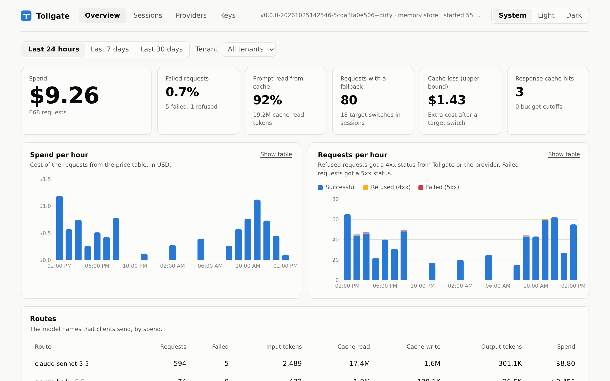
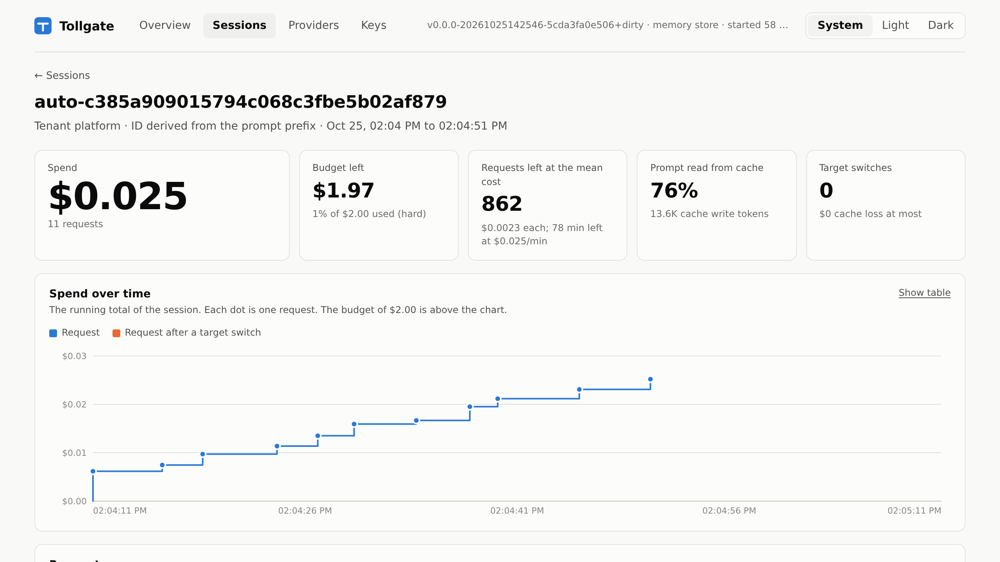
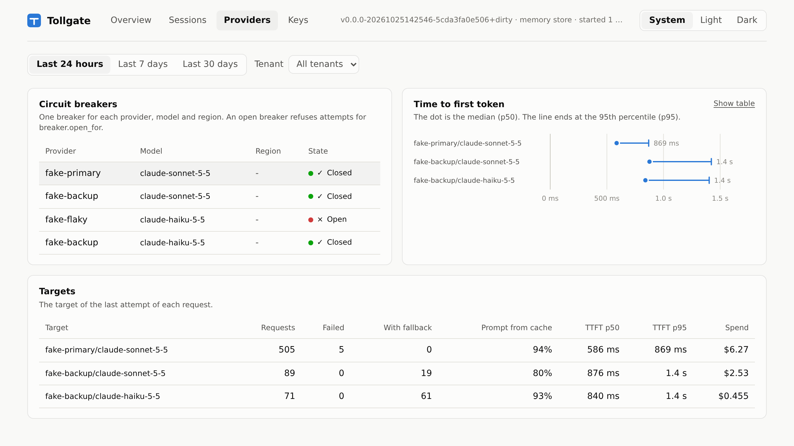

# Admin API and dashboard

This page describes the admin API, its data limits, and the dashboard embedded in the Tollgate binary.

## Access

The admin listener defaults to `127.0.0.1:9090`. It serves the dashboard at `/`, the API under `/admin/v1/`, and metrics at `/metrics`.
The data port does not expose these endpoints.

If `server.admin_token` is set, API, metrics and profile requests need `Authorization: Bearer <token>`.
A listener outside loopback requires that token. Static dashboard files contain no usage data and load without it.
The dashboard prompts for the token and stores it in `sessionStorage` for the browser tab.
Use HTTPS through a trusted reverse proxy for remote access. Tollgate does not terminate TLS on this port.

Prerequisites: a built binary and a valid configuration. See [quick start](../README.md#quick-start-with-the-fake-provider).

1. Start Tollgate:

   ```sh
   ./bin/tollgate serve -config tollgate.yaml
   ```

2. Open `http://127.0.0.1:9090/`.
3. Select Overview, Sessions, Providers or Keys. Select the tenant and time range as needed.
4. Select Light, Dark or System for the theme.

Result: one binary serves both the app and its API. No Node process or separate web server is needed.
If the page has no data, send a model request, check the tenant filter, and confirm the usage file path.
If the API returns status 401, enter the configured admin token.

## Endpoints

All endpoints below use `GET` and return JSON. Errors have an `error` string and a suitable HTTP status.
API responses use `Cache-Control: no-store`. No endpoint returns key hashes, provider secrets or prompt bodies.

| Path | Result |
| --- | --- |
| `/admin/v1/info` | Version, start time, store, usage sink, session settings, retained event count and capacity. |
| `/admin/v1/usage` | `from`, `to`, `group_by` and aggregate `groups`. |
| `/admin/v1/sessions` | `from`, `to`, `total` and the most recent `sessions`, with budget projections. |
| `/admin/v1/sessions/{id}` | One `session` with projection and up to 500 recent `events`. |
| `/admin/v1/breakers` | Current breaker state for each provider, model and region. |
| `/admin/v1/keys` | Configured tenants, key IDs, model permissions, budgets, rate limits and current-month key usage. |

Usage and session-list queries accept `tenant`, `session`, `key`, `from` and `to`.
Times use RFC 3339. The range includes `from` and excludes `to`. The default range is the last 24 hours.
`from` must be before `to`. Invalid filters return status 400.

Usage queries accept `group_by`: `none` (default), `tenant`, `key`, `session`, `route`, `provider`, `hour` or `day`.
Money totals use integer micro-USD. TTFT percentiles use milliseconds and are `null` when no event has a measurement.
Hour and day groups use UTC. Non-time groups sort by cost, then request count.

Session lists accept `limit` from 1 to 500, default 50. `total` counts all matched sessions before that limit.
Session detail accepts `tenant`. If two tenants have the same session ID, omit neither tenant nor the distinction.
An ambiguous session returns status 400; an unknown session returns status 404.
Session detail includes all retained history for that session, independent of the list time range.

```sh
curl 'http://127.0.0.1:9090/admin/v1/usage?tenant=personal&group_by=session'
curl 'http://127.0.0.1:9090/admin/v1/sessions?limit=20'
curl 'http://127.0.0.1:9090/admin/v1/sessions/my-task?tenant=personal'
```

For a token-protected listener, add the bearer header from your secret store.
The Keys page is read-only. Create keys with `tollgate keys create`, then edit the YAML configuration and restart Tollgate.
Key mutation and configuration reload endpoints are not implemented in this version.

## Data limits

The API uses a bounded in-memory index, default `usage.index_events: 100000`.
At start, the process reads the JSONL file into the index. New events enter the index directly, before async file writes.
When full, the index replaces the oldest retained event. With `usage.sink: none`, it holds only events since start.

The API shows this process's retained events. It does not query Redis budget counters or combine histories from multiple copies.
Projections and month totals can be incomplete after eviction or if the file contains only part of a tenant's history.
The CLI report reads the file directly and is suitable for larger historical reports.
Breaker states are current process state; TTFT percentiles are from retained usage events.

The dashboard polls every 10 s. Session timelines display up to 500 events.
The overview has spend, request and error totals, time charts, cache tokens and fallbacks.
The Providers page has breaker states and TTFT percentiles. Keys shows configured key IDs and month usage.
Charts also offer tables. The app follows the system theme unless a user selects Light or Dark.

## Build and demo

Prerequisites: Node.js with npm, Go from `go.mod`, and GNU Make.
The repository commits `web/dist`, so ordinary Go builds need no Node installation.

1. After a change in `web/src`, build the dashboard:

   ```sh
   make web
   ```

2. Build the binary with those assets:

   ```sh
   make build
   ```

3. Start the reproducible dashboard demo:

   ```sh
   make dashboard-demo
   ```

Result: the demo starts fake providers and Tollgate, seeds seven days of synthetic history, and sends live synthetic requests.
Open `http://127.0.0.1:9090/`. Stop the demo with Ctrl-C.
If a port is occupied, stop the existing service before the demo. Demo files stay in a temporary directory.
Never use the demo key outside the demo.

CI runs `make web-check` to detect stale committed assets. Commit the source and `web/dist` together.
For local UI development, `cd web && npm run dev` uses the Vite proxy configuration.

## Screenshots

These screenshots use synthetic demo history and fake providers. They show no production traffic or measured live-provider savings.

<picture>
  <source media="(prefers-color-scheme: dark)" srcset="assets/dashboard-overview-dark.png">
  
</picture>

<picture>
  <source media="(prefers-color-scheme: dark)" srcset="assets/dashboard-session-dark.png">
  
</picture>

<picture>
  <source media="(prefers-color-scheme: dark)" srcset="assets/dashboard-providers-dark.png">
  
</picture>
